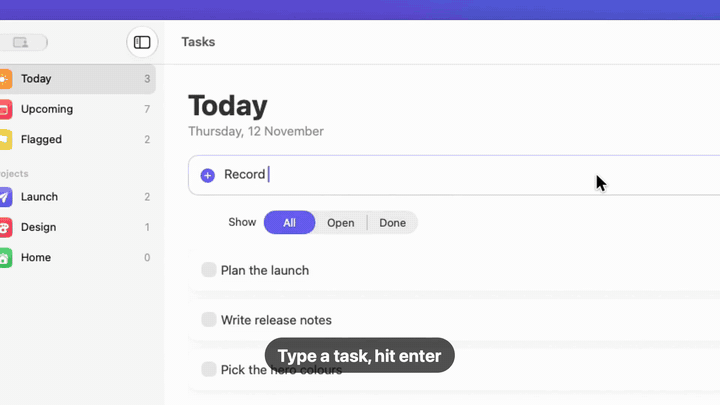

# Tasks for Mac

**The blazingly-fast todo list app for macOS.** You type in a task, hit enter, and it's there instantly.
100% local, free, open-source, and privacy-friendly.

**Built & filmed 100% by Claude Code.**

[](media/demo.mp4)

▶️ [Watch the full demo with sound (23 s)](media/demo.mp4) — this video was not recorded or edited by a human: Claude Code
drove the app and [ShowTake](https://showtake.app/?utm_source=github&utm_medium=readme&utm_campaign=tasks-for-mac)
filmed it, zoomed on every action, added the captions and the music.

## Features

- **Instant**: type a task, press Return, done. No sign-in, no sync spinner, no loading screen.
- **Today view** with All / Open / Done filters and a "Clear done" button.
- **Projects** (Launch, Design, Home) with live counts in the sidebar.
- **Local-only storage**: your tasks are one JSON file on your Mac
  (`~/Library/Application Support/TasksForMac/tasks.json`). The app never touches the network.
- Native SwiftUI, light and dark mode, one small source file you can read in five minutes.

## Install

Requires macOS 26 and Xcode 26 (or the matching Swift toolchain).

```sh
git clone https://github.com/phuctm97/tasks-for-mac.git
cd tasks-for-mac
./scripts/build-app.sh      # builds build/Tasks.app (release, ad-hoc signed)
open build/Tasks.app
```

Or just run it from source: `swift run`.

## How the code was written

Every line in [`Sources/TasksForMac/TasksForMac.swift`](Sources/TasksForMac/TasksForMac.swift) was written by Claude
Code: the SwiftUI views, the sidebar with project counts, the filters, and the tiny JSON store. The controls carry
accessibility identifiers (`new-task`, `add-task`, `filter`, `task-list`, `clear-done`), which is what lets an AI agent
operate the app reliably.

## How the demo was filmed

The video was filmed by Claude Code using [ShowTake](https://showtake.app/?utm_source=github&utm_medium=readme&utm_campaign=tasks-for-mac),
a Mac app with a built-in MCP server that lets your coding agent film polished demos of your own iOS and Mac apps.
Claude Code planned the steps and drove the real app through ShowTake's MCP tools:

```text
prepare_macos → launch_app → start_take → type_text ×3 → tap ×4 → end_take → render (music, captions, cards) → export
```

ShowTake recorded every action with its exact position and time, zoomed on each one, sped up the pauses, mixed the
music and exported the video. The exact steps are saved in [`demo/flow.yaml`](demo/flow.yaml), so the same demo can be
re-filmed after any change without an AI model.

Want the same for your app? Paste `showtake.app` into Claude Code (or any coding agent) and ask, for example:

```text
Make a short demo video of my app with captions and music.
```

## Privacy

No accounts, no analytics, no network requests. Delete the app and its JSON file and nothing of it is left.

## License

[MIT](LICENSE)
